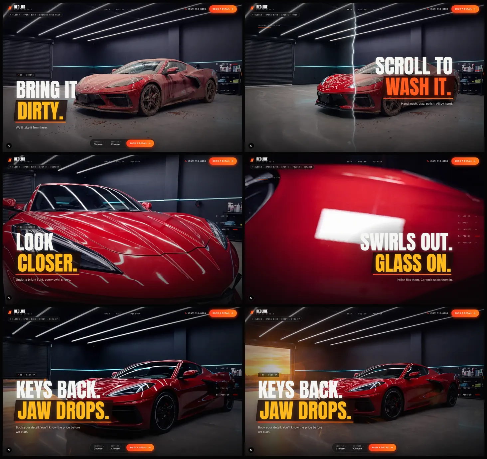
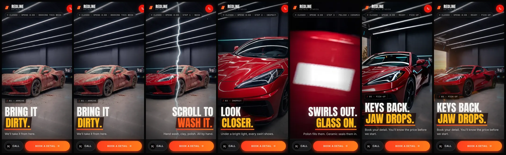
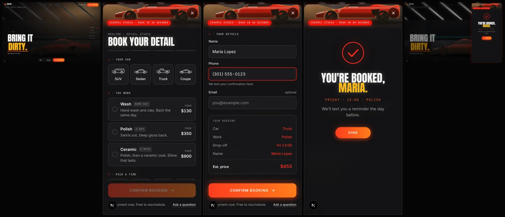
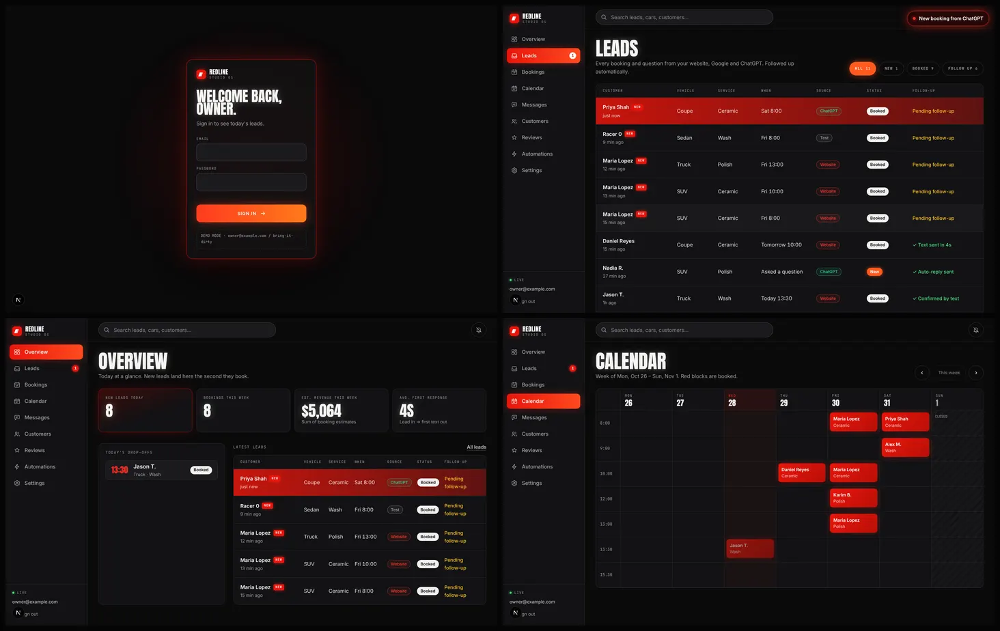
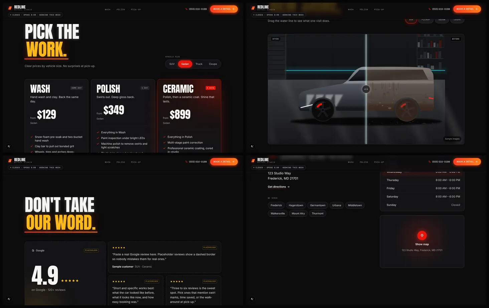

# BRING IT DIRTY: detailing studio template

A swappable website template for premium car-detailing studios, in three connected parts:

1. **The Film** (`/`): a pinned, scroll-scrubbed homepage. A filthy supercar in a dark studio: lights flick on, a glowing water line washes it clean, the camera pushes in on swirl marks, they polish out, a water bead forms on the ceramic, and the camera pulls back to golden hour. Trust and SEO sections follow (pricing, before/after, reviews, how it works, hours, FAQ).
2. **The Booking Drawer**: car → work → day and time → details, with a live summary and price. About 30 seconds on a phone. Full slots can't be double-booked.
3. **The Owner OS** (`/admin`): owner login, a live Leads dashboard (new bookings slide in with a toast), lead detail panel, overview KPIs, bookings by day, a week calendar, and automation status.

The demo brand is **REDLINE DETAIL STUDIO** (Frederick, MD). Every brand string, price, hour and asset path lives in `src/site.config.ts`.

Screens (photoreal assets generated in Higgsfield: Nano Banana Pro stills, Kling 3.0 clips):







---

## Quick start (demo mode, no accounts needed)

```bash
npm ci
cp .env.example .env.local
npm run dev
```

- Site: http://localhost:3000
- Owner OS: http://localhost:3000/admin/login, with `owner@example.com` / `bring-it-dirty` (from `DEMO_OWNER_*`; the hint shows on the login page in dev).
- Book something in one browser while `/admin/leads` is open in another: the row slides in live with the red highlight and a toast.

**Demo mode** runs whenever Supabase isn't configured. Leads live in memory and in `.data/leads.json`, realtime uses Server-Sent Events, and the owner login is a signed cookie. It's meant for laptops and sales demos. On serverless hosts each instance has its own memory, so **production needs Supabase.**

Useful in demos:
- `DEMO_SIMULATE_SMS=1` makes new leads show "✓ Text sent in {n}s" after a few seconds, without Twilio. It's off by default, and the Automations page labels it as simulated.
- Settings → **Reset demo data** restores the six reference leads, with times relative to now. `npm run seed` does the same from the CLI.

---

## Going live with Supabase

1. Create a Supabase project.
2. Apply the schema. Either `supabase link` then `supabase db push`, or paste `supabase/migrations/20261028000000_init.sql` into the SQL editor. It creates `leads` and `admins`, RLS policies, the realtime publication, and `book_slot()`.
3. Put these in `.env.local` (and in Vercel): `NEXT_PUBLIC_SUPABASE_URL`, `NEXT_PUBLIC_SUPABASE_ANON_KEY`, `SUPABASE_SERVICE_ROLE_KEY`.
4. Create the owner login:
   ```bash
   npm run create-owner -- owner@studio.com 'a-long-password'
   ```
   This creates the Supabase Auth user and adds the email to `public.admins`. `OWNER_EMAILS` (comma-separated) is an extra allow-list.
5. Optional: `npm run seed` for the demo rows (it only deletes and re-inserts its own six sample phone numbers).

How the security fits together:
- Inserts happen only server-side with the service role. The browser never writes to the database.
- Owners read and update leads through **their own session**, so the RLS policies `admins read leads` / `admins update leads` are the gate, not just app code.
- A signed-in user who isn't on the allow-list is signed out and shown "Not authorized."
- `middleware.ts` guards `/admin/*` and `/api/admin/*`. The admin layout and every admin API route check the allow-list again.

### Double-booking protection
`POST /api/bookings` calls `book_slot(p_lead, p_bays)`. That function takes a Postgres advisory lock per slot, recounts active bookings, and inserts in one transaction. Two people grabbing the last slot get one booking and one `409`, and the drawer then shakes the time row, refreshes availability, and says "That time just got booked. Pick another?"

Tested:
- `tests/sql/race.sh` fires 8 parallel `book_slot()` calls at one slot on real Postgres 16: 1 row, 7 `slot_full`.
- `tests/api-race.mjs` fires 6 parallel HTTP bookings at one slot: one `201`, five `409`.
- `tests/sql/rls.sql`: a stranger sees 0 leads, the owner sees all of them, and `anon` can't call `book_slot`.

Run the SQL tests against any Postgres with `tests/sql/supabase-shim.sql` loaded first, which stands in for Supabase's `auth.jwt()`, roles and publication.

### Availability rules
- Days come from `hours`, times from `booking.slotTimes`, and capacity from `booking.bays`.
- A slot counts as taken by `kind='booking'` leads with status `new` or `booked`.
- Online booking needs at least 60 minutes' notice and closes 60 days out.
- **Multi-day services block their drop-off slot only.** A 2-day Ceramic booked Thursday 10:00 doesn't block Friday. That keeps the logic simple. If a studio's bays fill up with multi-day jobs, raise `bays` or add the check in `src/lib/availability.ts`.
- The ready date is drop-off plus `durationDays`, pushed past closed days.

---

## Notifications and automations

All of these are optional and switched on by env vars:

| What | Needs | Behaviour |
|---|---|---|
| Instant confirmation text | `TWILIO_ACCOUNT_SID`, `TWILIO_AUTH_TOKEN`, `TWILIO_FROM_NUMBER` | Customer gets `copy.smsCustomer`. The lead's follow-up reads `✓ Text sent in {n}s`. |
| Owner new-lead alert | Twilio + `OWNER_ALERT_PHONE` | You get `copy.smsOwner`. |
| Every lead to your automations | `N8N_WEBHOOK_URL` | The full lead JSON is POSTed (`event: lead.created`). Without Twilio, follow-up reads `✓ Auto-reply sent`. |
| Day-before reminder | `CRON_SECRET` + Twilio or n8n | `vercel.json` calls `/api/cron/reminders` at 19:00 and 20:00 UTC. Only the run that lands on 15:00 studio time sends, so it's DST-proof. Sets `✓ Reminder sent`. |
| Rate limiting | optional `UPSTASH_REDIS_REST_*` | 5 bookings / 10 min per IP. In-memory LRU, or Upstash on serverless. |

With none of these set, follow-up reads `Pending follow-up`. Notifications run in `after()`, so the visitor's response never waits on Twilio or n8n.

US SMS: register an A2P 10DLC campaign in Twilio before texting customers (see LAUNCH_CHECKLIST.md).

### Source attribution
The first touch is stored per tab in `sessionStorage`. `utm_source` wins. Otherwise the referrer is mapped: google → Google, chatgpt.com / chat.openai.com → ChatGPT, perplexity.ai → Perplexity, instagram → Instagram, facebook → Facebook, bing → Bing, anything else → Website. The source shows as a coloured pill in the dashboard.

---

## The film and the asset pipeline

The film is a `<canvas>` image sequence, not a scrubbed `<video>`, which stutters on Safari and phones. It's pinned with CSS `position: sticky` for `film.scrollLength` viewport heights. GSAP ScrollTrigger reads the progress, and Lenis does the smooth scrolling on the same ticker.

| Chapter | Range | What draws |
|---|---|---|
| 01 Arrive | 0–0.10 | `S2_dirty_dark`. **Lights-on** plays once after 1% of scroll or 1.8s idle: `C1_lights_on` frames, or a code flicker crossfade to `S1_dirty_lit` |
| 02 Wash | 0.10–0.32 | **Wash wipe** between `S1` (dirty) and `S0` (clean): a simplex-noise water edge, bloom, wet sheen, glints, and spray that scales with scroll speed |
| 03 Inspect | 0.32–0.50 | frames of `C2_push_inspect` + `C3_into_macro` |
| 04 Polish + ceramic | 0.50–0.72 | frames of `C4_polish` + `C5_bead`. The headline hands over to a HUD tag during the bead |
| 05 Pick-up | 0.72–1.00 | frames of `C6_pull_back`, then `S7_pickup_golden` holds from 0.90 |

Loading: the `S2` poster `` paints first. The canvas, frame fetching and Lenis start once the page is idle, or on the first scroll. Frames are fetched by priority (what's just ahead first, every 8th frame before the rest), and only a window around the scroll position is decoded, so phones don't run out of memory. A draw is never blank: if a frame isn't decoded yet, the nearest one is used.

**Reduced motion or no JavaScript**: the same DOM becomes five stacked full-height sections, each with its still and headline. It's pure CSS, with no pin and no scrub.

### Assets from Higgsfield
1. Generate the Part B files in the Higgsfield web app. Save them into `assets-src/` with the exact names (see `assets-src/README.md`).
2. `npm run frames` builds `public/frames/{chapter}/{desktop|mobile}/0001.webp…`, `public/stills` (WebP + AVIF), `public/gallery`, `public/og/og-base.jpg`, the drawer ribbon crop, and `public/frames/manifest.json`. Frame counts per chapter come from `film.chapters[n].frames`. `C6a_`/`C6b_` splits are joined alphabetically. The script is idempotent: it hashes its inputs and skips anything unchanged. `--force` rebuilds everything.
3. Anything missing is substituted and listed in **`ASSETS_TODO.md`**:
   - missing clip, real stills present → Ken Burns crossfade between the stills
   - missing mobile file → center crop of the desktop file
   - nothing at all → **procedural placeholder art** (`scripts/lib/placeholder-art.mjs`): a stylised studio and supercar with real camera moves, so the film is fully demo-able today
4. `npm run check-align` writes a difference image of S0 vs S1 to `tmp/` and suggests `film.washAlign`. Then open `/?align=1` (dev): the wash shows a 50% difference blend, the arrow keys nudge it, `[` `]` scale it, and the panel prints the values to paste into the config.
5. Tune `focalX` / `focalY` per chapter so the car stays framed on ultra-wide and tall screens.

Budgets: desktop frames 1600w WebP q62 (≤70KB each), mobile 720×1280 q60 (≤35KB). The script warns when a chapter goes over. The current film is 13.7MB desktop / 6.8MB mobile, loaded progressively.

Commit `public/` after running the pipeline. Vercel has no ffmpeg, so frames are built locally.

---

## Reskin for a new studio (about 10 minutes)

1. `src/site.config.ts`: brand, city, phone, address, geo, hours, timezone, bays, slot times, services and prices, size multipliers, chapter copy, FAQ, reviews (real ones only), gallery flag, SEO strings, theme colours.
2. Drop their Higgsfield files into `assets-src/`, then run `npm run frames` and `npm run check-align`.
3. Set the env vars (Supabase, owner, Twilio / n8n if used, `NEXT_PUBLIC_SITE_URL`).
4. `npm run create-owner -- their@email 'password'`
5. Work through `LAUNCH_CHECKLIST.md`.

Proof that no brand strings live outside the config. This prints nothing:

```bash
grep -rnE "REDLINE|DETAIL STUDIO|Frederick|010-0199|book@example\.com|Studio Way|21701" src --include=*.ts --include=*.tsx --include=*.css | grep -v src/site.config.ts
```

---

## Scripts

| Command | What it does |
|---|---|
| `npm run dev` / `build` / `start` | Next.js |
| `npm run lint` / `typecheck` | ESLint (clean) / `tsc --noEmit` (strict) |
| `npm run frames` | asset pipeline (`--force`, `--only=stills\|frames\|gallery`) |
| `npm run check-align` | wash alignment helper |
| `npm run seed` | demo leads (Supabase or local) |
| `npm run create-owner -- email password` | owner login + allow-list |
| `npm run test:visual` | Playwright: film at 7 scroll points × 1440×900 and 390×844, one-headline rule, reduced-motion stack, keyboard-only booking, axe (WCAG 2.1 AA) on `/` and `/admin/login`, admin guard. Screens go to `test-results/screens/`. Use `BASE_URL=http://localhost:3001` to test a production server. |

`/styleguide` (dev only, or with `ENABLE_STYLEGUIDE=1`) renders every primitive and state.

## Quality (latest run, production build)

| | Mobile | Desktop |
|---|---|---|
| Lighthouse Performance | 95 | 100 |
| Accessibility | 100 | 100 |
| Best Practices | 100 | 100 |
| SEO | 100 | 100 |
| CLS | 0.001 | 0 |
| LCP | 1.7s with applied 4G throttling; 2.9s in Lighthouse's default simulated estimate (see note) | 0.6s |
| First-load JS for `/` | 176KB (budget 180KB) | |

Note on mobile LCP: the LCP element is the "DIRTY." headline, which really paints at first paint (195ms unthrottled). Lighthouse's default *simulated* mode charges every request that starts before that paint (fonts, poster, app JS) to the LCP estimate. Measured with real applied throttling (`--throttling-method=devtools`), LCP is 1.7s.

## Project map

```
src/site.config.ts          every brand string, price, hour, asset path, theme token
src/app/page.tsx            film + sections + JSON-LD
src/app/api/*               availability, bookings, questions, cron/reminders, admin/*
src/app/admin/*             login, (shell) layout, leads, overview, bookings, calendar, automations, stubs
src/components/film/*       FilmStage, FilmRenderer, FrameSequence, WashWipe, Particles, LightsOn, chrome
src/components/booking/*    BookingDrawer and its steps, SummaryCard, SuccessView, Confetti, icons
src/components/sections/*   trust and SEO sections
src/components/admin/*      LeadsProvider (realtime), LeadsTable, LeadPanel, Sidebar, screens
src/lib/*                   db adapters, availability, pricing, schemas (zod, shared), time (TZ-safe), notify, auth
supabase/                   migration + seed.sql
scripts/                    build-frames, placeholder art, check-wash-align, seed, create-owner
tests/                      Playwright suite, SQL race + RLS tests, API race test
```

## Deploying
See LAUNCH_CHECKLIST.md → Deploy. `vercel.json` holds the cron jobs. Frame caching headers are in `next.config.ts`. Nothing has been deployed and no external project has been created.
